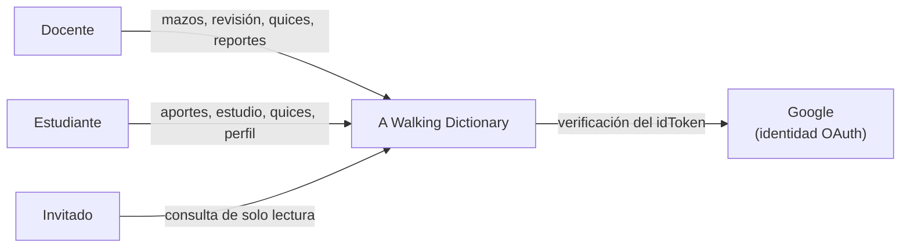
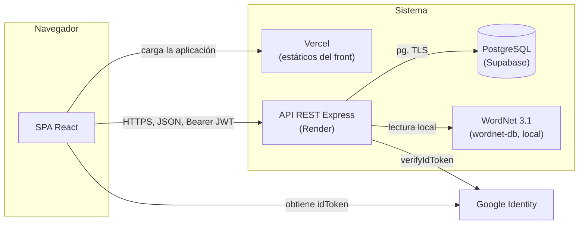

# 3. Contexto y alcance del sistema

## 3.1 Contexto de negocio

| Actor / sistema externo | Entrada hacia el sistema | Salida del sistema |
| --- | --- | --- |
| Docente | Crea mazos, revisa y aprueba tarjetas, asigna etiquetas de contexto, genera quices, inscribe estudiantes | Listados, analítica de participación, PDF de mazos, quices y reportes |
| Estudiante | Registra palabras, estudia con SM-2, responde quices, edita su perfil, se inscribe con un código | Notas y resultados, tarjetas aprobadas, sugerencias de palabras relacionadas |
| Invitado | Consulta el diccionario | Solo lectura, sin edición (CA-5.4.3) |
| Google | Entrega el `idToken` del usuario | Confirma identidad y correo verificado |
| Free Dictionary API | — | Prevista en DP-08 como apoyo opcional, **no implementada** hoy |

## 3.2 Contexto técnico

| Canal | Origen → destino | Protocolo y formato | Seguridad |
| --- | --- | --- | --- |
| Carga de la aplicación | Navegador → Vercel | HTTPS, HTML y JS estáticos | — |
| Llamadas a la API | SPA → API | HTTPS, JSON, cabecera `Authorization: Bearer <JWT>`, base `/api/v1` | CORS por lista (`CORS_ORIGINS`), `helmet`, límite de intentos en `/auth` y de peticiones en `/reports` |
| Inicio de sesión | SPA → Google | Google Identity Services (`@react-oauth/google`) entrega el `idToken` | Client ID de OAuth |
| Verificación del token | API → Google | `google-auth-library` (`verifyIdToken`) | Valida la audiencia contra `GOOGLE_CLIENT_ID` |
| Base de datos | API → PostgreSQL | `pg` (pool de conexiones) sobre TCP | TLS con verificación de certificado (`DB_SSL`, CA en `backend/certs/`) |
| Léxico | API → WordNet | `node-wordnet` + `wordnet-db`, lectura de archivos locales | — |
| Monitoreo | Plataforma → API | `GET /health` responde `{ status: "ok" }` | Pública |

## 3.3 Alcance

**Dentro del sistema:** SPA, API REST, esquema de base de datos y generación de PDF y reportes.
**Fuera del sistema:** la infraestructura de Google, Vercel, Render y Supabase; los libros del curso; y el contenido del curso en sí (el sistema solo guarda el vocabulario que aporta la comunidad).