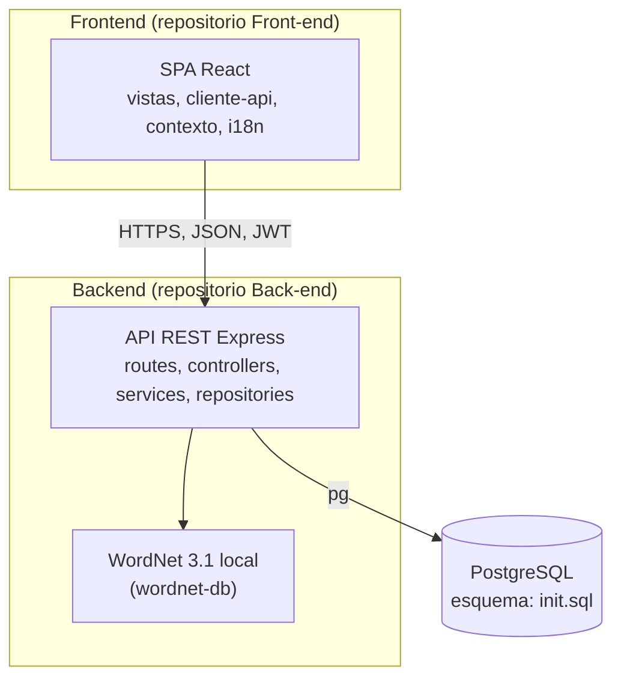
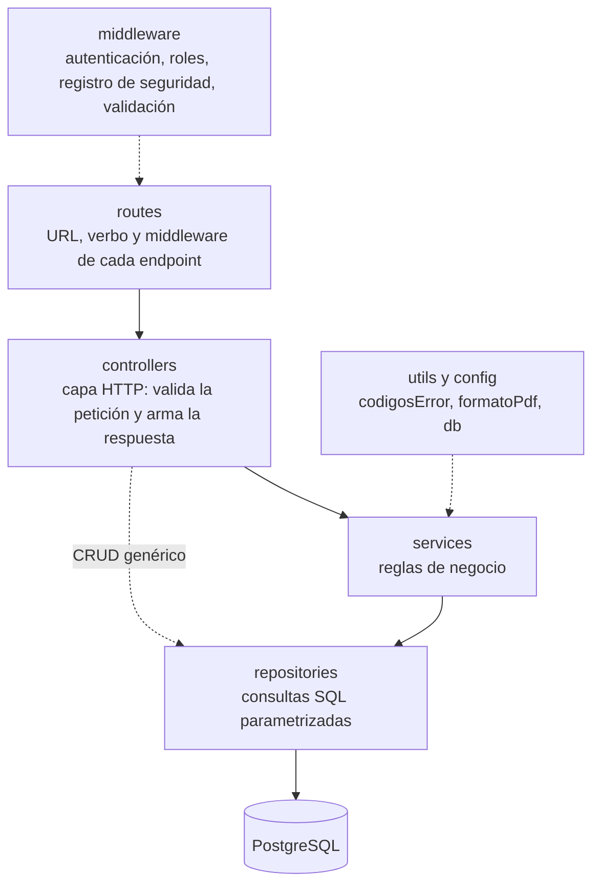

# 5. Vista de bloques de construcción

Datos tomados del código de la rama `develop` a la fecha de esta revisión.

## 5.1 Nivel 1: el sistema completo

| Bloque | Responsabilidad | Tecnología | Ubicación |
| --- | --- | --- | --- |
| SPA | Interfaz por rol (docente, estudiante, invitado), rutas protegidas, llamadas a la API | React 19, Vite, `react-router-dom`, `react-i18next` | Repositorio Front-end, `src/` |
| API | Reglas de negocio, autenticación, acceso a datos, generación de PDF | Node.js 20+, Express 4 | Repositorio Back-end, `backend/src/` |
| Base de datos | Persistencia e integridad (únicos, claves foráneas) | PostgreSQL 16 | `init.sql` (esquema), `seed.sql` (datos de prueba) |
| Léxico | Sugerencias de palabras relacionadas | `node-wordnet` + `wordnet-db` | Dependencias del backend |

## 5.2 Nivel 2: backend

La dependencia va en un solo sentido: `routes` → `controllers` → `services` → `repositories` → PostgreSQL. La regla se relaja en el CRUD genérico, donde el controlador llama directo al repositorio (así lo indican las cabeceras de esos controladores).

| Capa | Carpeta (`backend/src/`) | Responsabilidad | Cantidad |
| --- | --- | --- | --- |
| Rutas | `routes/` | Asocian URL y verbo con un controlador y sus middleware | 21 archivos |
| Controladores | `controllers/` | Leen `req`, validan lo básico y responden con el código HTTP | 23 |
| Servicios | `services/` | Reglas de negocio (duplicados, SM-2, calificación, PDF, reglas de acceso de reportes) | 25 |
| Repositorios | `repositories/` | Acceso a datos con SQL parametrizado, una clase por tabla o consulta | 21 |
| Modelos | `models/` | Clases que representan las tablas del DER | 14 |
| Middleware | `middleware/` | `autenticacionMiddleware`, `registroSeguridadMiddleware`, `validacionMiddleware` (reservado) | 3 |
| Utilidades | `utils/`, `config/` | `codigosError`, `formatoPdf`, pool de PostgreSQL (`db.js`) | 3 |

### Módulos por área funcional

| Área | Controlador(es) | Servicio(s) | Repositorio(s) |
| --- | --- | --- | --- |
| Autenticación y registro | `AutenticacionController`, `RegistroController` | `AutenticacionService`, `RegistroService` | `UsuarioRepository` |
| Perfil y contexto del estudiante | `UsuarioController` | `PerfilService` | `UsuarioRepository` |
| Mazos | `MazoController` | `ExportarPDFService` (PDF del mazo) | `MazoRepository` |
| Tarjetas y aportes | `TarjetaController`, `AporteController` | `TarjetaService`, `DeduplicacionService` | `TarjetaRepository`, `AporteRepository` |
| Curaduría y contexto cultural | `TarjetaController` | `CuraduriaService`, `ContextoService` | `TarjetaRepository`, `EtiquetaContextoRepository`, `AporteRepository` |
| Cursos e inscripción | `CursoController`, `InscripcionController` | `InscripcionService` | `CursoRepository`, `InscripcionRepository` |
| Analítica de participación | `AnaliticaController` | — | `AnaliticaRepository` |
| Quices | `QuizController`, `ResultadoQuizController` | `QuizService`, `ExportarPDFService` (PDF del quiz) | `QuizRepository`, `PreguntaQuizRepository`, `ResultadoQuizRepository`, `RespuestaQuizRepository`, `QuizMazoRepository` |
| Estudio (SM-2) | `EstudioController` | `EstudioService`, `SM2Service` | `EstudioRepository`, `ProgresoEstudioRepository` |
| Enriquecimiento léxico | `EnriquecimientoController` | `WordnetService` | `WordnetCacheRepository` |
| Diccionario global | `DiccionarioController` | `DiccionarioService` | `DiccionarioRepository` |
| Reportes en PDF | `ReporteEstudioController`, `ReporteProgresoController`, `ReporteCursoController`, `ReporteResultadosQuizController` | `Reporte{Estudio, Progreso, Curso, ResultadosQuiz}Service` y `...PDFService` | `Reporte{Estudio, Progreso, Curso, ResultadosQuiz}Repository` |

### Bloques sin uso activo

- **Servicios reservados, sin código:** `EnriquecimientoLexicoService` (la lógica real vive en `WordnetService`), `LimiteSemanalService` y `ModeracionService`. Ningún archivo los importa.
- **`validacionMiddleware`:** reservado; hoy las validaciones viven en controladores y servicios.
- **Routers CRUD no montados en `app.js`:** inscripción, etiqueta de contexto, pregunta de quiz, progreso de estudio, quiz-mazo, respuesta de quiz y resultado de quiz. No llevan `authenticate`, por lo que **no deben montarse sin protegerlos antes**.

## 5.3 Nivel 2: frontend

| Carpeta (`src/`) | Responsabilidad |
| --- | --- |
| `cliente-api/` | Un cliente HTTP por recurso (`authApi`, `mazosApi`, `quizzesApi`, `reportesApi`...) sobre `httpClient.js`, que añade el JWT. En `mocks/` están los datos simulados (`VITE_USE_MOCK=true`) |
| `contexto/` | `AuthProvider` (sesión en `localStorage`), `ThemeProvider` (tema claro u oscuro) y `EncabezadoProvider` (título de página) |
| `componentes/comunes/` | Componentes compartidos (por ejemplo `Aviso`, `BotonExportarPdf`) |
| `vistas/` | Pantallas por rol y área: `autenticacion`, `docente`, `estudiante`, `invitado`, `diccionario-global`, `mazos-estudio`, `quices` |
| `i18n/` | Configuración de `i18next` y los textos (`locales/en.json`) |

Rutas protegidas por rol en `src/App.jsx`:

| Prefijo | Pantallas |
| --- | --- |
| `/docente/...` | `mazos`, `revision-palabras`, `cursos`, `cursos/:id`, `participacion`, `quices`, `diccionario` |
| `/estudiante/...` | panel (raíz), `progreso`, `mazos`, `mazos/:idMazo/estudio`, `estudio`, `quices`, `quices/:idQuiz`, `configuracion-perfil`, `diccionario` |

Las rutas de login, registro e invitado están en el mismo `App.jsx`.

## 5.4 Nivel 3: servicios clave del backend

| Servicio | Responsabilidades principales |
| --- | --- |
| `QuizService` | `generar` (selección aleatoria y distractores sin repetir), `enviarRespuestas` (ventana de tiempo, calificación, transacción), `obtenerPreguntasParaEstudiante`, `listarDelEstudiante`, `obtenerResultadoEstudiante` |
| `SM2Service` | Recalcula factor de facilidad (mínimo 1.3), intervalo y próxima fecha de repaso según la valoración |
| `DeduplicacionService` | `normalizarPalabra` (recorte y minúsculas), `buscarDuplicado` por mazo y `resolverAporte` (coautoría o acepción nueva) |
| `AutenticacionService` | Verifica el `idToken` de Google, comprueba el usuario y emite el JWT |
| `WordnetService` | Consulta WordNet, usa la caché `wordnet_cache` y valida la palabra recibida |
| `ExportarPDFService` | Genera con `pdf-lib` los PDF de mazo y de quiz |