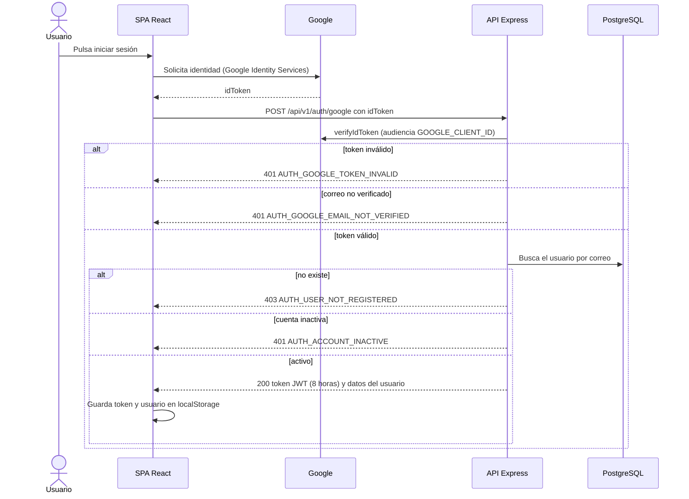
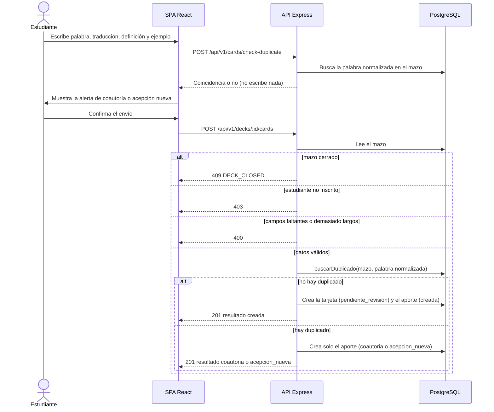
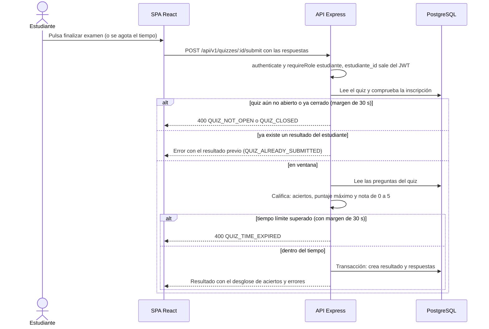
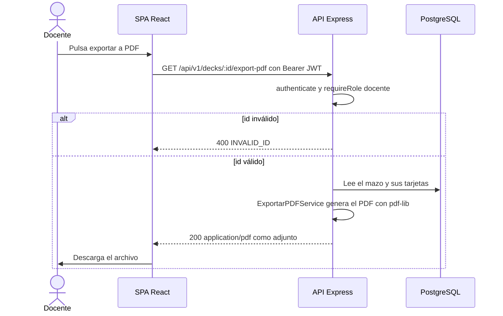

# 6. Vista de ejecución

Cuatro escenarios representativos, tomados del código.

## 6.1 Inicio de sesión con Google (CA-5.4.1)

Notas: el servicio no crea usuarios (el alta se hace en `POST /auth/register`); el JWT lleva `id_usuario`, `email` y `rol`; la contraseña nunca viaja.

## 6.2 Registrar una palabra con detección de duplicados (HU-1.2 y HU-1.3)

Notas: la comparación ignora mayúsculas y espacios (CA-1.3.3). El criterio exacto que distingue coautoría de acepción nueva está en `DeduplicacionService.resolverAporte` (supuesto pendiente P7; ver D-08).

## 6.3 Responder un quiz y recibir la nota (HU-3.2)

Notas: la unicidad `(quiz_id, estudiante_id)` del DER garantiza un solo intento; si dos envíos llegan a la vez, la violación de unicidad (23505) se traduce en el mismo error de reintento. La nota usa escala 0 a 5 (supuesto pendiente P2). El tiempo de inicio lo informa el cliente (limitación conocida).

## 6.4 Exportar un mazo a PDF (HU-3.3)

Los reportes en `/api/v1/reports/...` siguen el mismo patrón, con límite de peticiones y reglas de acceso propias de cada servicio.