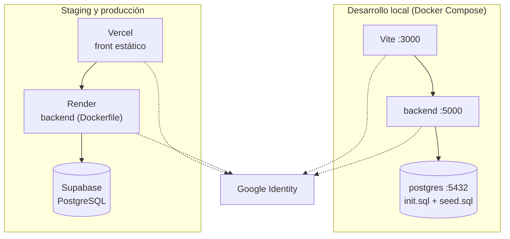

# 7. Vista de despliegue

## 7.1 Infraestructura por entorno

| Entorno | Frontend | Backend | Base de datos |
| --- | --- | --- | --- |
| Desarrollo | `npm run dev` (Vite, puerto 3000) o su `Dockerfile` (Node 22) | Contenedor `backend` (puerto 5000) de `docker-compose.yml` o `npm run dev` | Contenedor `postgres` (`postgres:16-alpine`, puerto 5432), con `init.sql` y `seed.sql` en el primer arranque |
| Staging | Vercel (vista previa de cada PR) | Render | Proyecto Supabase separado, con datos de prueba |
| Producción | Vercel (rama `main`; `vercel.json` reescribe todas las rutas a `index.html`) | Render | Supabase |

Fuente de staging y producción: `docs/ai/CONTEXTO_PROYECTO.md` (2.8). **Confirmar con quien tenga el rol DevOps** los detalles de cada plataforma, porque no hay workflow de despliegue en los repositorios.

## 7.2 Configuración de la base de datos en Supabase

- Conexión con TLS verificado: `DB_SSL=true` y el certificado CA en `backend/certs/` (`DB_SSL_CA_PATH`).
- RLS habilitado en las tablas (hallazgo H-05 de la auditoría OWASP).
- Connection pooling en producción.

## 7.3 Variables de entorno

| Variable | Dónde | Descripción |
| --- | --- | --- |
| `DB_HOST`, `DB_PORT`, `DB_USER`, `DB_PASSWORD`, `DB_NAME` | Backend | Conexión a PostgreSQL |
| `DB_SSL`, `DB_SSL_CA_PATH` | Backend | TLS hacia la base de datos |
| `JWT_SECRET` | Backend | Firma del JWT |
| `GOOGLE_CLIENT_ID` | Backend | Audiencia con la que se valida el `idToken` |
| `CORS_ORIGINS` | Backend | Orígenes del front permitidos |
| `PORT`, `NODE_ENV` | Backend | Puerto y modo de ejecución |
| `RATE_LIMIT_AUTH_MAX`, `RATE_LIMIT_REPORTES_MAX` | Backend | Límites de peticiones (por defecto 20 y 30) |
| `DISABLE_AUTH`, `DISABLE_AUTH_ROL` | Backend | **Solo desarrollo local.** Nunca en producción |
| `VITE_API_BASE_URL`, `VITE_GOOGLE_CLIENT_ID`, `VITE_USE_MOCK` | Frontend | URL de la API, Client ID de Google y modo simulado |

El detalle y los valores por defecto están en los README de cada repositorio.

## 7.4 Pipelines de integración continua (GitHub Actions)

| Workflow | Repositorio | Cuándo se ejecuta | Qué hace |
| --- | --- | --- | --- |
| Backend tests | Back-end | Push y PR a `develop` y `main` | `npm ci`, lint, pruebas con cobertura y análisis de SonarQube Cloud |
| Backend pruebas funcionales | Back-end | Push y PR a `develop` y `main` | Levanta PostgreSQL y el backend y ejecuta una prueba por criterio de aceptación |
| Seguridad OWASP | Back-end | Push, PR y manual | Descarga backend y frontend, levanta una base aislada, ejecuta la suite OWASP y genera el informe |
| CodeQL | Ambos | Push y PR; además cada lunes a las 06:00 UTC | Análisis estático de seguridad |
| Reconstruir SUPERPROMPT | Back-end | Cada lunes a las 11:00 UTC, manual y al fusionar en `develop` | Reconstruye el contexto del proyecto y abre un PR de revisión humana |
| Frontend CI | Front-end | Push y PR a `develop` y `main` | Lint, pruebas unitarias con cobertura, SonarQube y build |
| Frontend pruebas E2E | Front-end | Push y PR | Levanta PostgreSQL, el backend (`develop`) y el frontend, y ejecuta Playwright |
| Avisar al SUPERPROMPT | Front-end | Al fusionar en `develop` | Avisa al backend para reconstruir el SUPERPROMPT |

## 7.5 Observaciones conocidas del entorno local

- `docker-compose.yml` no pasa `CORS_ORIGINS` al contenedor del backend; sin esa variable el backend rechaza a todos los navegadores.
- El servicio `backend` usa `backend/Dockerfile` (arranca con `node server.js`) pero monta `./backend` en `/app`; el código montado no es el que corre, así que hay que reconstruir con `--build` tras cada cambio.
- El servicio `frontend` del compose está comentado.
- Los contadores de límite de peticiones están en memoria y se reinician cuando Render reinicia el servicio.